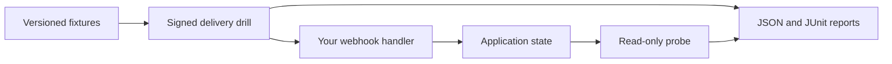

# Webhook Drill

**Test what a webhook does, not just what it returns.**

[](https://github.com/ABRJrocks/webhook-drill/actions/workflows/ci.yml)
[](pyproject.toml)
[](LICENSE)

Webhook Drill is a dependency-free Python CLI for repeatable webhook reliability tests. Replay signed fixtures, send concurrent duplicates, deliver events out of order, and verify the resulting application state. Use JSON suites locally or make them a gate in your CI pipeline.

A handler can return `200` eight times and still create eight orders. A state probe catches that failure. The included broken receiver demonstrates it.

```text
PASS    Concurrent duplicate delivery / Deliver the same event eight times
PASS    Concurrent duplicate delivery / Only one side effect occurred
PASS    Out-of-order domain revisions / State was not rolled back
...
4/4 scenarios passed
```

## Try it locally

Requires Python 3.10 or later. There is no PyPI release yet. Install from this repository or the wheel attached to the GitHub release.

```bash
git clone https://github.com/ABRJrocks/webhook-drill.git
cd webhook-drill
python -m venv .venv
source .venv/bin/activate
python -m pip install .
export WEBHOOK_DRILL_SECRET=webhook-drill-demo-only
webhook-drill demo
```

In another terminal, activate the same environment and run:

```bash
export WEBHOOK_DRILL_SECRET=webhook-drill-demo-only
webhook-drill run examples/reliability.json \
  --target http://127.0.0.1:8765 \
  --json-report reports/results.json \
  --junit reports/junit.xml
```

All four scenarios should pass. Stop the demo with Ctrl+C, restart it with `webhook-drill demo --broken`, and run the same command. The duplicate and ordering scenarios should fail, with exit code `1`.

The demo secret is public and works only with the local teaching receiver. For your own endpoints, use a dedicated staging signing secret through an environment variable.

## What it checks

| Capability | How it works |
| :--- | :--- |
| Concurrent duplicates | Repeat the same body with a bounded worker pool, then assert the side-effect count |
| Out-of-order events | Describe the delivery sequence explicitly, then inspect the final application state |
| Retry recovery | Retry connection errors, timeouts, `408`, `429`, and `5xx`; check the final response and state |
| Signature validation | GitHub HMAC-SHA256 and Stripe timestamped HMAC over the exact body bytes |
| Negative authentication | Missing, invalid, stale Stripe signatures, and post-signing body tampering |
| Eventual state | Poll a read-only endpoint until its JSON assertions pass or the window expires |
| Contract assertions | Status codes, response headers, latency, and RFC 6901 JSON pointers |
| CI results | Nonzero exit codes, redacted JSON reports, and JUnit XML |



## Write a suite for your application

Copy the example and replace the webhook path, payload, and state-probe path. `{{run_id}}` gives each run a unique namespace and stays identical within that run. The probe should read a real result, such as an order count, CRM version, queued task count, or workflow execution record.

```json
{
  "version": 1,
  "name": "Order automation",
  "scenarios": [{
    "name": "A retried order must not create duplicate tasks",
    "steps": [
      {"name": "Duplicate the event", "send": {
        "path": "/hooks/orders",
        "body": {"event_id": "{{run_id}}", "order_id": "test-{{run_id}}"},
        "repeat": 5,
        "concurrency": 3,
        "expect": {"status": [200, 202]}
      }},
      {"name": "Check the business result", "probe": {
        "path": "/test-state/orders/test-{{run_id}}",
        "eventually": 5,
        "expect": {"status": [200], "json": {"/created_tasks": 1}}
      }}
    ]
  }]
}
```

Unsigned suites support internal webhook workflows. Add a `signing` object for a provider-signed integration. To preserve a captured request byte for byte, use `body_file` instead of `body`. Fixture files stay inside the suite directory.

Validate without sending requests:

```bash
webhook-drill run suite.json --target http://127.0.0.1:8000 --dry-run
```

Run against a staging origin you control:

```bash
webhook-drill run suite.json \
  --target https://staging.example.com \
  --allow-remote --junit reports/webhooks.xml
```

The target is an origin, not a full webhook URL. Paths belong in the suite. Remote targets require HTTPS and explicit opt-in. Redirects are never followed; TLS certificate verification stays enabled.

## Integrate it

- [Suite reference](docs/suites.md): fields, signatures, retry behavior, bounds, and assertions.
- [CI and application integration](docs/integrations.md): a GitHub Actions recipe and Python API usage.
- [Research and design decisions](docs/research.md): the documented failure modes and existing alternatives.
- [Security and limitations](SECURITY.md): data handling and what the tool does not prove.

Reports omit request bodies, response bodies, headers, signing secrets, and target URLs. They retain scenario names, the run ID, statuses, timings, attempts, and redacted failure descriptions. Keep secrets out of scenario names.

## Development

```bash
python -m pip install -e .
python -m unittest discover -s tests -v
```

The test suite uses real local HTTP servers and checks both correct and broken demo receivers. CI runs the suite on Python 3.10, 3.12, and 3.13, then builds and installs a wheel.

**Status:** early release. This is a test runner for local and staging workflows, not a production webhook gateway or a load-testing service. It does not claim exactly-once delivery. State assertions only prove the properties you explicitly check.

MIT licensed. Built and maintained by [Abdul Rafay](https://www.rafayai.dev).

